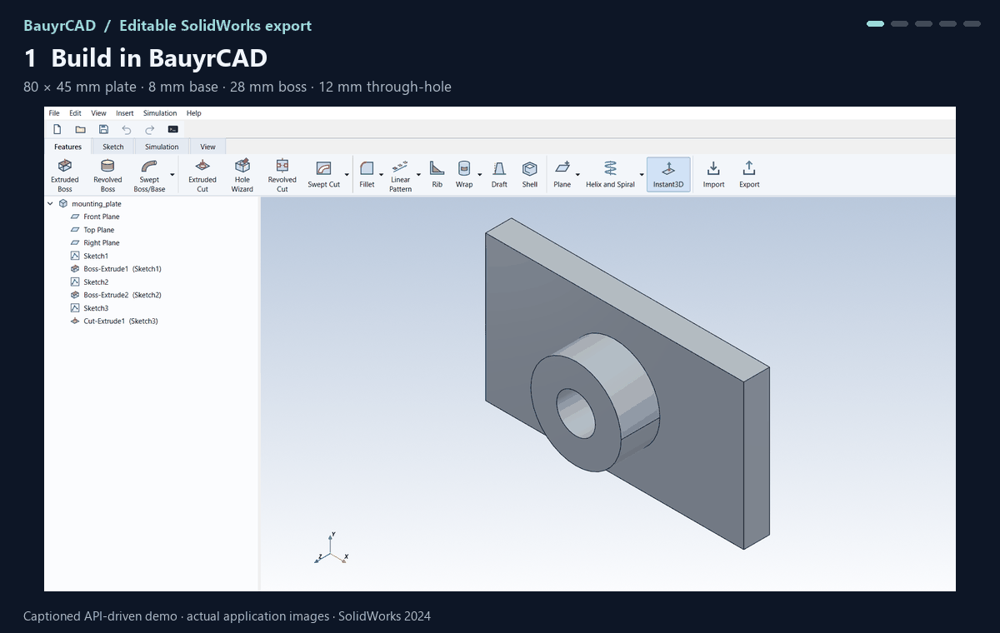

# Editable SolidWorks export demo



This 24-second captioned animation uses a real BauyrCAD window capture and model images
exported by SolidWorks. It is an **API-driven demonstration, not a continuous mouse recording**.
The native feature list and dimension values are read from SolidWorks; the side panel is an
explanatory overlay, not a recreation of its user interface. Captures were made on 2026-11-02.
The validation installation identified itself as **SolidWorks Student Edition — Academic Use
Only**, as labelled in the animation. No licence or endorsement claim is made by this demo.

## What it demonstrates

1. BauyrCAD creates an 80 × 45 × 8 mm plate, a 28 mm diameter boss with 20 mm extrusion
   depth from the front plane, and a 12 mm diameter through-hole.
2. `export_solidworks_offline(..., require_native=True)` writes the `.SLDPRT`. No SolidWorks
   process was running before or after this export. The report contains six native entries
   and no warnings: three sketches, two bosses and one cut.
3. SolidWorks opens and rebuilds the exported file with native features.
4. Its own API changes `D1@Boss-Extrude2` from 0.020 m to 0.035 m, then rebuilds.
5. The edited file is saved, closed and reopened. The dimension remains 35 mm, and the native
   features and rebuilt geometry persist.

| State | Boss extrusion depth | Volume | Rebuild |
|---|---:|---:|---|
| Offline file opened in SolidWorks | 20 mm | 33,927.0792 mm³ | Clean |
| Dimension edited in SolidWorks | 35 mm | 41,466.9016 mm³ | Clean |
| Edited file saved and reopened | 35 mm | 41,466.9016 mm³ | Clean |

Both volumes match the analytic plate + boss − through-hole calculation. The boss depth
is measured from the front plane, so its protrusion above the 8 mm plate changes from
12 mm to 27 mm. [Machine-readable validation results](media/solidworks-export-validation.json).

## Reproduce the model

From the repository root, with the BauyrCAD environment installed:

```powershell
.\.venv\Scripts\python.exe examples\solidworks_export_demo.py --output demo-output
```

Open `demo-output/mounting_plate.bcad` in BauyrCAD. Open the generated
`demo-output/mounting_plate.SLDPRT` in an appropriately licensed SolidWorks installation.
Edit `Boss-Extrude2` and change its blind depth to 35 mm; rebuild, save and reopen.
The supplied example only writes the initial export and never starts SolidWorks.

This verifies this particular supported feature history. It does not imply that every
BauyrCAD operation exports as an editable feature; see the [coverage tracker](SW_FEATURE_COVERAGE.md).
