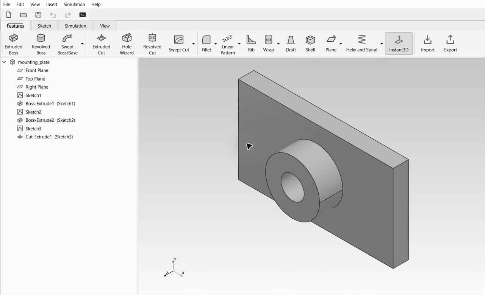

# Editable SolidWorks export demo



[Watch the full-resolution video](media/solidworks-window-demo-v6.mp4).

This 37-second recording shows the real BauyrCAD and SolidWorks interfaces: the offline
export menu and save dialog, the native feature tree, and the Boss-Extrude2 PropertyManager.
The depth is entered as 35 mm in the actual editor, then accepted and rebuilt.

Idle time is removed and some sections are accelerated. The footage is grayscale, and
status bars are cropped. There are no recreated controls or presentation panels. The
SolidWorks API selects the feature and opens its native editor; keyboard input enters and
accepts the dimension. API readback independently verifies the result. Recorded on 2026-11-02.
No licence or endorsement claim is made by this demo.

## What it demonstrates

1. The BauyrCAD model is an 80 × 45 × 8 mm plate, a 28 mm diameter boss with 20 mm
   extrusion depth from the front plane, and a 12 mm diameter through-hole.
2. File > Export editable SolidWorks part (offline) writes the native `.SLDPRT`.
   No SolidWorks process was running when this recorded export completed.
3. SolidWorks opens the exported part with native sketches, bosses and a cut.
4. The Boss-Extrude2 editor changes its depth from 20 to 35 mm and rebuilds the model.
5. Readback confirms a 35 mm depth, a clean rebuild, and a volume of 41,466.9016 mm³.
   The edited file is saved.

The depth is measured from the front plane, so the boss protrusion above the 8 mm plate
changes from 12 to 27 mm. The volume matches the analytic plate + boss − through-hole
calculation. A separate earlier validation of this same model also verified that the 35 mm
dimension and native features survive saving, closing and reopening.

[Machine-readable validation results](media/solidworks-export-validation.json) include the
recorded UI edit and the earlier API-driven rebuild/reopen checks.

## Reproduce the model

From the repository root, with the BauyrCAD environment installed:

```powershell
.\.venv\Scripts\python.exe examples\solidworks_export_demo.py --output demo-output
```

Open `demo-output/mounting_plate.bcad` in BauyrCAD. Open the generated
`demo-output/mounting_plate.SLDPRT` in an appropriately licensed SolidWorks installation.
Edit `Boss-Extrude2` and change its blind depth to 35 mm; rebuild, save and reopen.
The supplied example only writes the initial export and never starts SolidWorks.

This verifies this particular supported feature history. It does not imply that every
BauyrCAD operation exports as an editable feature; see the [coverage tracker](SW_FEATURE_COVERAGE.md).
